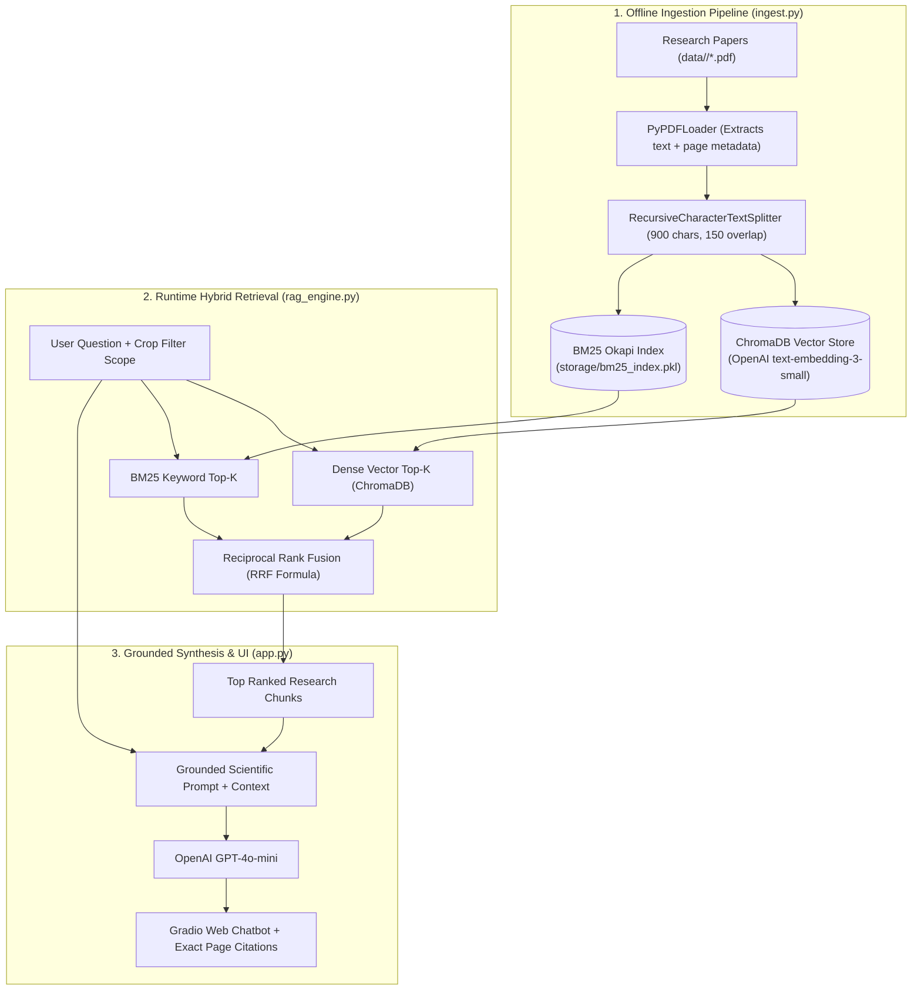

# 🌱 HydroRAG — Precision Hydroponics Knowledge Assistant

[](https://www.python.org/)
[](https://www.langchain.com/)
[](https://www.trychroma.com/)
[](https://github.com/dorianbrown/rank_bm25)
[](https://platform.openai.com/)
[](https://gradio.app/)
[](https://huggingface.co/spaces/vedantsable/HydroRAG)
[](https://opensource.org/licenses/MIT)

> A domain-specific **Hybrid RAG (Retrieval-Augmented Generation)** assistant that answers precision hydroponic and controlled-environment farming questions grounded in **peer-reviewed scientific literature** and agricultural extension guides.

Try the live demo: [HydroRAG on Hugging Face Spaces](https://huggingface.co/spaces/vedantsable/HydroRAG).

---

## 🚨 The Problem: Why General LLMs Fail at Hydroponics

In soilless hydroponics (NFT, DWC, substrate gutters), plants have zero soil buffering capacity. A slight drift in **Electrical Conductivity (EC)**, root zone **pH**, dissolved oxygen, or **Vapor Pressure Deficit (VPD)** triggers severe physiological disorders (such as Blossom-End Rot or tipburn) within hours.

Standard LLMs face two major issues:
1. **Hallucinations & Soil Bias:** Generates generic soil fertilizer advice or incorrect NPK ratios that cause osmotic shock in water culture.
2. **Dense Vector Search Blind Spots:** Semantic embedding models often blur exact numbers and chemical formulas (`EC 1.2` vs `EC 2.4`, `Fe-EDDHA` vs `Fe-EDTA`).

---

## ⚡ The Solution: Hybrid Search + Reciprocal Rank Fusion (RRF)

**HydroRAG** combines **Dense Semantic Search** (ChromaDB) with **Sparse Lexical Search** (BM25 Okapi) fused via **Reciprocal Rank Fusion (RRF)**:

$$\text{RRF Score}(d) = \frac{1}{60 + \text{rank}_{\text{dense}}(d)} + \frac{1}{60 + \text{rank}_{\text{bm25}}(d)}$$

- **ChromaDB** captures conceptual semantic meaning (e.g., matching *"water culture"* with *"hydroponics"*).
- **BM25 Okapi** pinpoints exact scientific acronyms and numbers (e.g., `EC 2.2 dS/m`, `Pythium`, `pH 5.8`).
- **RRF** dynamically merges both leaderboards to deliver zero-miss scientific precision.

---

## 🏗️ System Architecture



---

## ✨ Key Features

- **⚡ Hybrid RRF Search:** Combines semantic vector similarity with BM25 keyword matching for high-precision retrieval.
- **🌱 Crop-Specific Scoping:** Metadata filtering allows targeting specific crops (`tomatoes`, `lettuce`, `strawberries`, `cucumbers`, `basil`, `capsicum`) or querying across the entire corpus.
- **📄 Verifiable Evidence:** Every generated answer cites exact source PDFs and page numbers.
- **💬 Small-Talk Bypass:** Gracefully handles greetings without wasting database queries or printing false citations.
- **🎨 Clean Gradio UI:** Minimalist, fast, and human-crafted web interface without bloated templates.
- **🤗 Hugging Face Space:** Hosted demo on the free tier, with ZeroGPU support for Space runtimes.

---

## 📁 Project Structure

```
HydroRAG/
├── data/                       # Curated scientific research papers by crop
│   ├── tomatoes/               # Tomato microclimate & nutrient formulation studies
│   ├── lettuce/                # Butterhead & NFT system comparisons
│   ├── strawberries/           # Substrate salinity & root zone thermal studies
│   ├── basil/                  # Essential oil synthesis & EC studies
│   ├── cucumbers/              # Commercial cucumber production & oxygen guides
│   └── capsicum/               # Sweet pepper microclimate & VPD studies
│
├── storage/                    # Generated at runtime (git-ignored)
│   ├── chroma_db/              # Persistent Chroma vector store
│   └── bm25_index.pkl          # Serialized BM25 Okapi index
│
├── config.py                   # Central settings, paths, models, and crop taxonomy
├── ingest.py                   # PDF loader, text chunker, and dual-index builder
├── rag_engine.py               # Hybrid search (RRF) and GPT-4o-mini synthesis
├── app.py                      # Interactive Gradio web interface
│
├── requirements.txt            # Python dependencies
└── .gitignore                  # Git exclusion rules
```

---

## 🚀 Quick Start

You need **Python 3.10+** and an **OpenAI API key**. Prefer the [live demo](https://huggingface.co/spaces/vedantsable/HydroRAG) if you only want to try questions without a local setup.

### 1. Clone the Repository
```bash
git clone https://github.com/vedantsable56/HydroRAG.git
cd HydroRAG
```

### 2. Set Up Virtual Environment

Using **uv** (recommended for high speed):
```bash
uv venv .venv --python 3.12
.\.venv\Scripts\activate          # On Windows
# source .venv/bin/activate       # On Linux / macOS
uv pip install -r requirements.txt
```

Or standard **pip**:
```bash
python -m venv .venv
.\.venv\Scripts\activate          # On Windows
# source .venv/bin/activate       # On Linux / macOS
pip install -r requirements.txt
```

### 3. Configure API Key
Create a `.env` file in the project root:
```env
OPENAI_API_KEY=your_openai_api_key_here
```

### 4. Build the Dual Indices
Process and index your research papers into ChromaDB and BM25:
```bash
python ingest.py
```
*(Processes all PDFs in `data/`, chunks pages, and generates both vector and sparse indices in `storage/`)*

### 5. Launch the Web Application
```bash
python app.py
```
Open **`http://127.0.0.1:7860`** in your browser.

---

## 💬 Example Output

> **User:** *"What is the ideal temperature for tomatoes in hydroponics?"*
> 
> **HydroRAG:**
> - **Germination:** Optimum soil temperature is ~29.5°C (tolerable range 16–29.5°C) `[2]`.
> - **Development Stages:** Leaf and truss development thrives at ~22°C; fruit addition and growth are best at 22–26°C `[3]`.
> - **Air Temperature:** Maintain average temperature between 17–27°C; temperatures below 12°C significantly reduce yield and quality `[1]`.
> 
> **Sources:**
> - `[1] tomatoes_02.pdf (Page 4)`
> - `[2] tomatoes_02.pdf (Page 4)`
> - `[3] tomatoes_02.pdf (Page 3)`

---

## 📄 License

This project is licensed under the **MIT License**.

---

<p align="center">
  <b>Built by Vedant Sable</b><br>
  <i>An end-to-end domain-specific RAG system for precision agriculture and controlled-environment farming.</i>
</p>
